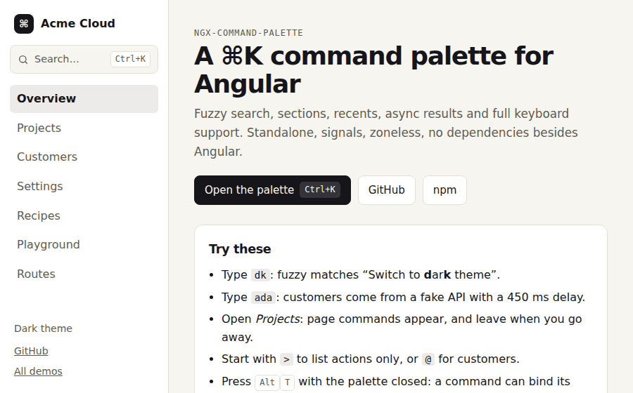

# ngx-command-palette

An accessible **⌘K / Ctrl+K command palette for Angular**, built the Angular way: standalone components, signals, zoneless-ready and **no dependencies besides Angular** (and `tslib`, see below).

[](https://github.com/rrstudioapps/ngx-command-palette/actions/workflows/ci.yml)
[](https://www.npmjs.com/package/@rrstudioapps/ngx-command-palette)
[](LICENSE)

**[Live demo →](https://rrstudio.app/command-palette/)**



## Features

- Opens with **⌘K / Ctrl+K** (configurable, multiple shortcuts allowed), closes with **Esc** or a click outside
- **Fuzzy search** with highlighted matches, case and accent insensitive, smart ranking (word starts, consecutive letters)
- Commands grouped in **sections**, with optional **icon**, **description**, **shortcut hint** and extra **keywords**
- Each command either **navigates to a route** or **runs a function**; optionally **built from your router configuration**
- Optional **Recent** section, stored in `localStorage`
- **Async providers** (e.g. customer search on your API) with debounce, loading state and request cancellation
- Register commands **from any component** with signals; they are **removed automatically** when the component is destroyed
- Full **keyboard navigation**: ↑ ↓, Home / End, Enter, Ctrl+N / Ctrl+P
- **Accessible**: dialog + combobox/listbox pattern, `aria-activedescendant`, focus trap, focus restore, live region, `prefers-reduced-motion`
- **Themeable** with CSS variables (`--rr-cp-*`), light and dark themes, no Tailwind required
- Custom **templates** for items and the empty state
- No browser globals at import time (SSR friendly), works with or without zone.js

| Light                                                                                                             | Dark                                                                                                            |
| ----------------------------------------------------------------------------------------------------------------- | --------------------------------------------------------------------------------------------------------------- |
|  |  |

## Installation

```bash
npm install @rrstudioapps/ngx-command-palette
```

Requires Angular 21 or 22 (`@angular/core`, `@angular/common`, `@angular/router`).

**Dependencies.** The library has no runtime dependency besides Angular, with one exception: [`tslib`](https://www.npmjs.com/package/tslib), the small helper library that the Angular package format (ng-packagr) requires for every Angular library. Angular itself depends on it, so it is already in your `node_modules` and adds nothing to your install. No `rxjs`, no polyfills, nothing else.

## Quick start (5 minutes)

**1. Configure it** (optional: without this call the defaults are used).

```ts
// app.config.ts
import { provideCommandPalette } from '@rrstudioapps/ngx-command-palette';

export const appConfig: ApplicationConfig = {
  providers: [provideRouter(routes), provideCommandPalette({ shortcut: 'mod+k' })],
};
```

**2. Place the palette once** and register some commands.

```ts
// app.ts
import { Component, inject } from '@angular/core';
import { CommandPaletteComponent, injectCommands } from '@rrstudioapps/ngx-command-palette';

@Component({
  selector: 'app-root',
  imports: [CommandPaletteComponent, RouterOutlet],
  template: `
    <router-outlet />
    <rr-command-palette />
  `,
})
export class App {
  private auth = inject(AuthService);

  constructor() {
    injectCommands([
      { id: 'home', label: 'Home', group: 'Navigation', route: '/' },
      {
        id: 'settings',
        label: 'Settings',
        group: 'Navigation',
        route: '/settings',
        keywords: ['preferences'],
      },
      { id: 'logout', label: 'Log out', icon: '🚪', run: () => this.auth.logout() },
    ]);
  }
}
```

**3. Press ⌘K / Ctrl+K.** That's it.

**4. Add page commands** from any component. They exist only while the component is alive.
Pass a signal to keep them in sync with your state:

```ts
@Component({/* … */})
export class ProjectsPage {
  projects = signal<Project[]>([]);

  constructor() {
    injectCommands(
      computed(() => [
        { id: 'project-new', label: 'New project', group: 'Projects', run: () => this.create() },
        ...this.projects().map((p) => ({
          id: `project-${p.id}`,
          label: `Open ${p.name}`,
          group: 'Projects',
          route: ['/projects', p.id],
        })),
      ]),
    );
  }
}
```

**5. Search your API** with an async provider:

```ts
injectCommandProvider({
  id: 'customers',
  group: 'Customers',
  minQueryLength: 2,
  search: async (query, signal) => {
    const res = await fetch(`/api/customers?q=${encodeURIComponent(query)}`, { signal });
    const customers: Customer[] = await res.json();
    return customers.map((c) => ({
      id: `customer-${c.id}`,
      label: c.name,
      description: c.email,
      route: ['/customers', c.id],
    }));
  },
});
```

`search` can also return an Observable (e.g. from `HttpClient`): anything with a `subscribe` method works.

## API

### `provideCommandPalette(options?)`

| Option                       | Type                                                                     | Default                                  | Description                                                                                                                                                                                                                                                                                                                                                                                                                                                                                                                                                                                                       |
| ---------------------------- | ------------------------------------------------------------------------ | ---------------------------------------- | ----------------------------------------------------------------------------------------------------------------------------------------------------------------------------------------------------------------------------------------------------------------------------------------------------------------------------------------------------------------------------------------------------------------------------------------------------------------------------------------------------------------------------------------------------------------------------------------------------------------- |
| `shortcut`                   | `string \| string[]`                                                     | `'mod+k'`                                | Toggle shortcut(s). `mod` is ⌘ on macOS/iOS and Ctrl elsewhere. Examples: `'ctrl+shift+p'`, `'/'`. Shortcuts without Ctrl/⌘/Alt are ignored while typing in a field. `[]` turns the shortcut off (`open()` still works).                                                                                                                                                                                                                                                                                                                                                                                          |
| `shortcutInFields`           | `boolean`                                                                | `true`                                   | With `false`, Ctrl/⌘ shortcuts (the palette's and command `hotkey`s) do not fire while typing in an input, textarea, select or contenteditable.                                                                                                                                                                                                                                                                                                                                                                                                                                                                   |
| `shortcutEnabled`            | `boolean \| (() => boolean)`                                             | `true`                                   | A function or a signal is read on every key press. While `false` the shortcut does not open the palette (and the key is left to the page); an open palette can still be closed with it, and `open()` always works.                                                                                                                                                                                                                                                                                                                                                                                                |
| `shortcutPreventDefault`     | `boolean`                                                                | `true`                                   | With `false` the shortcut does not call `preventDefault()` on the key event.                                                                                                                                                                                                                                                                                                                                                                                                                                                                                                                                      |
| `closeOnSelect`              | `boolean`                                                                | `true`                                   | With `false` the palette stays open after a command runs (see [Behavior and events](#behavior-and-events)). A command's `closeOnRun` wins.                                                                                                                                                                                                                                                                                                                                                                                                                                                                        |
| `onOpen`, `onClose`, `onRun` | `() => void`, `(reason) => void`, `(command) => void`                    | none                                     | Event callbacks. `reason` is `'escape' \| 'overlay' \| 'run' \| 'toggle' \| 'api'`.                                                                                                                                                                                                                                                                                                                                                                                                                                                                                                                               |
| `restoreFocus`               | `boolean \| (() => HTMLElement \| null)`                                 | `true`                                   | Where the focus goes when the palette closes: back to the element that had it before opening (default), nowhere (`false`) or to the element your function returns. See [Behavior and events](#behavior-and-events).                                                                                                                                                                                                                                                                                                                                                                                               |
| `position`                   | `'top' \| 'center'`                                                      | `'top'`                                  | Vertical position of the window. `--rr-cp-top` applies to `'top'`.                                                                                                                                                                                                                                                                                                                                                                                                                                                                                                                                                |
| `sectionOrder`               | `string[]`                                                               | `[]`                                     | Order of the sections while the search is empty: section ids or group names.                                                                                                                                                                                                                                                                                                                                                                                                                                                                                                                                      |
| `theme`                      | `'light' \| 'dark' \| 'auto'`                                            | `'auto'`                                 | `auto` follows `prefers-color-scheme`.                                                                                                                                                                                                                                                                                                                                                                                                                                                                                                                                                                            |
| `routes`                     | `boolean \| { group?, filter?, describe? }`                              | `false`                                  | Builds a command for every route of the router configuration (see [Commands from your routes](#commands-from-your-routes)).                                                                                                                                                                                                                                                                                                                                                                                                                                                                                       |
| `recent`                     | `{ max?, storageKey?, rank?, storage?, enabled? } \| false`              | `{ max: 5, storageKey: 'rr-cp:recent' }` | "Recent" section shown when the query is empty. `rank: 'frequent'` orders it by how often and how recently commands ran (count halves every 7 days). `storage` is where they are saved and `enabled` (boolean, function or signal) turns them on or off at runtime (see below).                                                                                                                                                                                                                                                                                                                                   |
| `debounceMs`                 | `number`                                                                 | `200`                                    | Debounce for async providers.                                                                                                                                                                                                                                                                                                                                                                                                                                                                                                                                                                                     |
| `maxResults`                 | `number`                                                                 | `50`                                     | Max local results for a non-empty query.                                                                                                                                                                                                                                                                                                                                                                                                                                                                                                                                                                          |
| `maxEmptyResults`            | `number`                                                                 | `100`                                    | Max commands listed when the search is empty (recents not counted). The rest is still found by typing. See [Many commands](#many-commands).                                                                                                                                                                                                                                                                                                                                                                                                                                                                       |
| `filter`                     | `(query, command) => { score, indices } \| null`                         | built-in fuzzy search                    | Your own matching and ranking of local commands. See [Custom search](#custom-search).                                                                                                                                                                                                                                                                                                                                                                                                                                                                                                                             |
| `prefixes`                   | `{ prefix, groups?, kind?, label? }[]`                                   | `[]`                                     | Search modes. See [Prefix modes](#prefix-modes).                                                                                                                                                                                                                                                                                                                                                                                                                                                                                                                                                                  |
| `labels`                     | `Partial<CommandPaletteLabels> \| (() => Partial<CommandPaletteLabels>)` | English                                  | All texts, for translations. A function or a signal is read reactively: when a signal it reads changes (e.g. the language), the open palette updates. The texts are: `placeholder`, `dialog`, `listbox`, `empty`, `loading`, `recent`, `pinned`, `routesGroup`, `prefixHints`, `prefixActions`, `prefixPages`, `defaultGroup`, `results` (`'{count} results'`), `resultsOne` (same, for exactly one result; default: `results`), `closeHint`, `back`, `level` (`'{name}: {count} results'`), `levelOne` (same, for one result; default: `level`), `submenu`, `prompt` (`'{name}: type a value and press Enter'`). |
| `showSectionLabels`          | `boolean`                                                                | `true`                                   | Shows the section headings (Recent, Pinned, groups). With `false` they are visually hidden and each group keeps its accessible name.                                                                                                                                                                                                                                                                                                                                                                                                                                                                              |
| `showPrefixHints`            | `boolean`                                                                | `false`                                  | Shows a row at the bottom with the search modes of `prefixes`. See [Prefix modes](#prefix-modes).                                                                                                                                                                                                                                                                                                                                                                                                                                                                                                                 |
| `showCloseHint`              | `boolean`                                                                | `true`                                   | Shows the close key (`labels.closeHint`, Esc) in the search field.                                                                                                                                                                                                                                                                                                                                                                                                                                                                                                                                                |
| `highlightMatches`           | `boolean`                                                                | `true`                                   | Highlights the characters found by the search.                                                                                                                                                                                                                                                                                                                                                                                                                                                                                                                                                                    |
| `showStatus`                 | `boolean`                                                                | `false`                                  | Shows the status line (e.g. "3 results") at the bottom of the window, with the class `rr-cp-status`. It is an `aria-live` region either way.                                                                                                                                                                                                                                                                                                                                                                                                                                                                      |

### Shortcut, recents and texts

```ts
const searchPageActive = signal(false); // set it from the page that has its own search

provideCommandPalette({
  // Do not fire Ctrl/⌘ shortcuts while the user types in a field
  shortcutInFields: false,
  // Pause the shortcut on pages with their own search; palette.open() still works
  shortcutEnabled: searchPageActive, // a signal, or any () => boolean
  // Keep recents per tab instead of in localStorage
  recent: { storage: sessionStorage },
});
```

`recent.storage` takes any object with synchronous `getItem`, `setItem` and `removeItem` (`localStorage`
and `sessionStorage` fit), so an in-memory one works too. Without it `localStorage` is used, and during SSR or when
the storage is blocked or throws, the recents just stay in memory.

`recent.enabled` and a `labels` function can follow your app's state, for example a language and a "remember my last choices" switch:

```ts
const lang = inject(LanguageService); // exposes a signal: lang.current()
const rememberChoices = signal(true);

provideCommandPalette({
  labels: () => TRANSLATIONS[lang.current()], // a Partial<CommandPaletteLabels>
  recent: { enabled: rememberChoices },
});
```

- **Labels:** the placeholder, status and screen reader texts, section headings (Recent, Pinned) and the default group change on the fly, also while the palette is open. Read a signal inside the function so Angular knows when to update; a plain function that reads nothing reactive is read once.
- **Recents on → off:** the section disappears, the list in memory is emptied and runs are neither recorded nor saved. What is already stored is kept (`clearRecent()` removes it).
- **Recents off → on:** the list is loaded again from the storage. If it starts off, the storage is never read. `recent: false` turns the feature off for good.

### Behavior and events

```ts
provideCommandPalette({
  closeOnSelect: false, // the palette stays open after a command runs…
  position: 'center',
  restoreFocus: () => document.querySelector<HTMLElement>('#main'), // or false
  sectionOrder: ['Navigation', 'recent'], // empty search only; Pinned stays on top
  onOpen: () => analytics.track('palette-open'),
  onClose: (reason) => console.log('closed:', reason),
  onRun: (command) => analytics.track('palette-run', { id: command.id }),
});

injectCommands([
  { id: 'theme', label: 'Toggle theme', run: toggleTheme }, // stays open
  { id: 'logout', label: 'Sign out', run: signOut, closeOnRun: true }, // …except this one
]);
```

- **`closeOnSelect` / `closeOnRun`:** a command's `closeOnRun` wins over the option, in both directions. Commands that open a sub-palette or ask for a value never close the palette. A `prompt` command that stays open returns to the list (empty search) after it runs. Recents are recorded either way, and the focus stays in the search field.
- **Events:** `onOpen` fires when the palette opens (not when `open()` is called while it is already open) and `onClose` when it closes, with the reason: `'escape'` (Esc key), `'overlay'` (click on the backdrop), `'run'` (a command ran), `'toggle'` (the shortcut or `toggle()`), `'api'` (`close()`). `onRun` fires after the command ran or navigated, also for route commands and when the palette stays open. It is not called if the command throws or its promise rejects (the error propagates as before).
- **`restoreFocus`:** by default the focus returns to the element that had it when the palette opened, which keeps keyboard and screen reader users where they were. `false` leaves it alone (e.g. when a command moves the focus itself). A function such as `restoreFocus: () => document.querySelector<HTMLElement>('#search')` picks the element; if it returns `null`, an element that is no longer in the page or throws (reported with `console.error`), the focus goes back to the original element.
- **Errors in callbacks** (also a rejected promise they return) are caught and reported with `console.error`: they never break the palette.
- **`sectionOrder`** lists section ids (`pinned`, `recent`, `g:<group>`, `p:<provider id>`) or plain group names. Listed sections come first in that order; Pinned and Recent stay on top unless listed; the others follow in registration order. A search is never reordered: it is ranked by score.

### Prefix modes

Start the search with a character to narrow the list, like `>` in VS Code. The prefix is removed from the
search text (and from `ctx.query`); the recents are not shown and async providers only run when the mode allows them.

```ts
provideCommandPalette({
  prefixes: [
    { prefix: '>', kind: 'action' }, // only commands that run a function
    { prefix: '/', kind: 'route' }, // only routes
    { prefix: '#', groups: ['Customers'] }, // only these sections (and providers)
  ],
});
```

Nobody guesses these shortcuts, so `showPrefixHints: true` adds a row at the bottom that lists them. Each hint is a button: selecting it types the prefix in front of the search text (selecting the active one removes it), which also makes the modes usable on a touch screen.

```ts
provideCommandPalette({
  showPrefixHints: true,
  prefixes: [
    { prefix: '>', kind: 'action' }, // shown as "> Actions" (`labels.prefixActions`)
    { prefix: '/', kind: 'route' }, // shown as "/ Pages" (`labels.prefixPages`)
    { prefix: '#', groups: ['Customers'] }, // shown as "# Customers"
    { prefix: '@', label: 'People' }, // an explicit label wins
  ],
});
```

A hint is named after its `label`, else its `groups`, else its `kind`; with none of them only the prefix is shown. The row is hidden when there are no prefixes, inside a sub-palette and while a command asks for a value. `labels.prefixHints` is its accessible name.

### Many commands

Searching is cheap: with 5,000 commands a keystroke costs a few tens of milliseconds. With an empty search,
though, every command is rendered, which takes roughly 0.2 s for a thousand commands and 0.6 s for five
thousand on a slow virtual server. That is why, until the user types, only the first `maxEmptyResults`
commands are listed (100 by default, in registration order; recents not counted). The rest is found by
searching, and opening takes the same time whatever the number of commands.

```ts
provideCommandPalette({ maxEmptyResults: Infinity }); // list them all
```

For very large catalogs, also consider [sub-palettes](#sub-palettes) or an async [provider](#commandprovider).

### Custom search

By default commands are matched with the built-in fuzzy search (label, keywords, description). Pass `filter`
to decide what matches and how results are ranked. Return `null` to hide a command; a higher `score` ranks first,
and `indices` are the label characters to highlight:

```ts
provideCommandPalette({
  // Only commands whose label starts with the query
  filter: (query, command) =>
    command.label.toLowerCase().startsWith(query.toLowerCase())
      ? { score: 1, indices: Array.from({ length: query.length }, (_, i) => i) }
      : null,
});
```

`filter` only applies to local commands with a non-empty query. Results of async providers keep the order
returned by your API. To build on the default behavior, call the exported `matchCommand(query, command)`.

### Sub-palettes

Give a command `children` and selecting it lists those commands instead of running something. The path of
opened parents shows above the search field, and the search only looks inside the current level:

```ts
injectCommands([
  {
    id: 'theme',
    label: 'Change theme',
    keywords: ['appearance'],
    children: [
      { id: 'theme-light', label: 'Light', run: () => setTheme('light') },
      { id: 'theme-dark', label: 'Dark', run: () => setTheme('dark') },
    ],
  },
]);
```

- **Backspace** on an empty search, the back button or a step of the path goes back; **Esc** closes the whole palette.
- Children can have children. They support `hidden` and `disabled` like any command.
- Running a child saves it in the recents, so it shows up at the top level afterwards. Parents are never saved.
- Async providers search the top level only, and only registered commands can have `children`
  (not the results of a provider).
- Screen readers hear the level name and the number of results when a sub-palette opens.

### `Command`

| Field                        | Type                                          | Description                                                                                                                                                                                                                                                                                                                                                              |
| ---------------------------- | --------------------------------------------- | ------------------------------------------------------------------------------------------------------------------------------------------------------------------------------------------------------------------------------------------------------------------------------------------------------------------------------------------------------------------------ |
| `id`                         | `string`                                      | Unique and stable (used for recents).                                                                                                                                                                                                                                                                                                                                    |
| `label`                      | `string`                                      | Shown and searched.                                                                                                                                                                                                                                                                                                                                                      |
| `group`                      | `string?`                                     | Section. Default: `labels.defaultGroup`.                                                                                                                                                                                                                                                                                                                                 |
| `description`                | `string?`                                     | Second line, searched with a lower weight.                                                                                                                                                                                                                                                                                                                               |
| `icon`                       | `string \| TemplateRef?`                      | Emoji/text/icon-font ligature, or a template (e.g. an SVG).                                                                                                                                                                                                                                                                                                              |
| `shortcut`                   | `string[]?`                                   | Keys shown on the right, e.g. `['⌘', 'S']`. Display only: use `hotkey` to bind a key.                                                                                                                                                                                                                                                                                    |
| `hotkey`                     | `string \| string[]?`                         | Key combination(s) that run the command even when the palette is closed, e.g. `'mod+s'`. It needs Ctrl, ⌘ or Alt; Alt-only combinations do not fire while typing in a text field (on macOS Alt types special characters), Ctrl and ⌘ ones do. Ignored for parents, disabled/hidden commands and while the palette is open. Shown on the row when there is no `shortcut`. |
| `keywords`                   | `string[]?`                                   | Extra search terms, not shown.                                                                                                                                                                                                                                                                                                                                           |
| `disabled`                   | `boolean?`                                    | Shown but not selectable.                                                                                                                                                                                                                                                                                                                                                |
| `closeOnRun`                 | `boolean?`                                    | Overrides `closeOnSelect` for this command: `false` keeps the palette open after it runs, `true` closes it even if the option is `false`. Ignored by parents.                                                                                                                                                                                                            |
| `children`                   | `Command[]?`                                  | Makes it a parent: selecting it opens a sub-palette with these commands instead of running something. See [Sub-palettes](#sub-palettes).                                                                                                                                                                                                                                 |
| `hidden`                     | `boolean \| (() => boolean)?`                 | Not listed and not searched. A function or a signal hides it depending on your app state, e.g. `hidden: () => !user()`.                                                                                                                                                                                                                                                  |
| `pinned`                     | `boolean \| (() => boolean)?`                 | Also listed in a "Pinned" section at the top while the search is empty (and not repeated in Recent). A function or a signal pins it depending on your app state.                                                                                                                                                                                                         |
| `route` + `navigationExtras` | `string \| any[]`, `NavigationExtras?`        | Navigate with the Angular router…                                                                                                                                                                                                                                                                                                                                        |
| `run`                        | `(ctx: { query, value? }) => void \| Promise` | …or run a function.                                                                                                                                                                                                                                                                                                                                                      |
| `prompt`                     | `string?`                                     | With `run`: asks for a value first. Selecting the command opens a second step whose field has this placeholder; Enter runs it with the text in `ctx.value` (nothing happens while empty), Backspace or the back button leaves the step. Example: `{ id: 'user', label: 'Go to user', prompt: 'User id…', run: ({ value }) => router.navigate(['/users', value]) }`.      |

### `CommandPaletteService`

| Member                                      | Description                                                                            |
| ------------------------------------------- | -------------------------------------------------------------------------------------- |
| `isOpen`, `query`, `loading`                | Read-only signals.                                                                     |
| `commands`, `sections`                      | Registered commands and the filtered, grouped results of the current level (signals).  |
| `path`                                      | The sub-palettes currently open, outermost first (signal).                             |
| `back(levels?)`                             | Goes back one or more levels of a sub-palette; returns `false` at the top level.       |
| `open(query?)`, `close()`, `toggle()`       | Open/close programmatically (e.g. from a "Search…" button).                            |
| `setQuery(query)`                           | Change the search text.                                                                |
| `register(commands \| signal, destroyRef?)` | Returns an unregister function. Inside an injection context it unregisters on destroy. |
| `registerProvider(provider, destroyRef?)`   | Same, for async providers.                                                             |
| `execute(command)`                          | Run a command as if selected.                                                          |
| `clearRecent()`                             | Forget the recents.                                                                    |

`injectCommands(commands)` and `injectCommandProvider(provider)` are shortcuts for
`register`/`registerProvider` bound to the current component.

### `CommandProvider`

| Field                   | Type                                          | Description                                                       |
| ----------------------- | --------------------------------------------- | ----------------------------------------------------------------- |
| `id`, `group`           | `string`                                      | Provider id and section title.                                    |
| `search(query, signal)` | `Promise<Command[]> \| Observable<Command[]>` | `signal` is aborted when the query changes or the palette closes. |
| `minQueryLength`        | `number?`                                     | Default `1`.                                                      |
| `debounceMs`            | `number?`                                     | Overrides the global debounce.                                    |

Async results keep the order returned by your API. Route commands from a provider are kept
in "Recent" even when they are no longer returned by the search.

### `<rr-command-palette>`

| Input   | Description                                                                            |
| ------- | -------------------------------------------------------------------------------------- |
| `theme` | Overrides the configured theme, e.g. `[theme]="appTheme()"` to follow your own toggle. |

The component also exposes `shortcutLabel` (`'⌘K'` or `'Ctrl+K'`) for your search button:
`<rr-command-palette #cp />` … `<kbd>{{ cp.shortcutLabel }}</kbd>`.

### Custom templates

```html
<rr-command-palette>
  <ng-template rrCommandItem let-command let-segments="segments" let-active="active">
    <my-icon [name]="command.id" />
    <span>
      @for (s of segments; track $index) { @if (s.match) { <b>{{ s.text }}</b> } @else { {{ s.text
      }} } }
    </span>
    @if (active) { <span class="hint">↵</span> }
  </ng-template>

  <ng-template rrCommandEmpty let-query>
    No results for “{{ query }}”. <a href="/help">Need help?</a>
  </ng-template>
</rr-command-palette>
```

Import `CommandItemTemplate` and `CommandEmptyTemplate` next to `CommandPaletteComponent`.
The item context also has `result` (score and indices) and `query`.

### Utilities

`fuzzyMatch(query, text)` returns `{ score, indices } | null`. `highlightSegments(text, indices)`
splits a string for highlighting. `parseShortcut`, `matchesShortcut` and `formatShortcut`
handle shortcut strings. All of them are exported if you want the same behaviour elsewhere.

## Recipes

### Commands from your routes

Turn on `routes` and every route of your router configuration becomes a navigation command, so a new page shows up in the palette without writing a command for it:

```ts
provideCommandPalette({ routes: true });
```

The label is the route's `title` when it is a string, otherwise the last path segment (`user-settings` becomes "User settings"). The commands are listed in the `labels.routesGroup` section ("Pages"). Routes are read each time the palette opens, so `router.resetConfig()` is picked up.

Left out: redirects, `**`, secondary outlets and paths with a parameter (`:id`), with everything below them. A route without a path that only wraps children (a layout) is not listed itself, but its children are. Route guards are not evaluated, so hide protected pages yourself.

Refine one route with `data.commandPalette` (`false` hides it), or many at once with `filter` and `describe`:

```ts
const routes: Routes = [
  {
    path: 'billing',
    component: Billing,
    data: { commandPalette: { label: 'Invoices', keywords: ['pay'] } },
  },
  { path: 'internal', component: Internal, data: { commandPalette: false } },
];

provideCommandPalette({
  routes: {
    group: 'Go to',
    filter: (route, url) => !url.startsWith('/admin'),
    describe: (route, url) => (url === '/' ? { label: 'Home', keywords: ['start'] } : {}),
  },
});
```

`filter` and `describe` run in an injection context each time the palette opens, so they can `inject()` a service (for example to look up an icon template). `describe` can return `null` to leave a route out. A command you register by hand with the same `id` (`route:/billing`) or the same `route` replaces the generated one, so you can add an icon, a shortcut or a description to a single page.

A route behind `loadChildren` is listed, but its children are only known to the router once they are loaded, so they are not generated: register them yourself.

**Translations (i18n).** Pass every text through `labels` (`t` stands for your translation function; the library does not need `@angular/localize`). Translate your own command labels the same way when you build them:

```ts
provideCommandPalette({
  labels: {
    placeholder: t('palette.placeholder'),
    empty: t('palette.empty'),
    recent: t('palette.recent'),
  },
});
```

**Commands that depend on the current page.** Register from the component that owns the page: they are removed when it is destroyed.

```ts
@Component({/* … */})
export class InvoicePage {
  protected readonly invoice = input.required<Invoice>();
  constructor() {
    injectCommands(
      computed<Command[]>(() => [
        { id: 'invoice.send', label: `Send ${this.invoice().number}`, run: () => this.send() },
      ]),
    );
  }
}
```

**A button that opens the palette.** Inject `CommandPaletteService` as `palette` and show the shortcut label of the component:

```html
<button (click)="palette.open()">Search <kbd>{{ cp.shortcutLabel }}</kbd></button>
<rr-command-palette #cp />
```

**Restricting commands by permission.** Use `hidden` with a signal so the command disappears from the list, the search and the recents:

```ts
{ id: 'admin.users', label: 'Manage users', route: '/admin/users', hidden: () => !auth.isAdmin() }
```

**Matching your UI kit.** The palette is self-contained and styled with CSS variables (see [Theming](#theming)), so you map them to your kit's tokens instead of wrapping it in another dialog. These tokens follow the kit's light/dark switch, so one block covers both themes. Token names checked against Angular Material 22.2, PrimeNG 22.1 (Aura preset) and Bootstrap 5.3.8.

```css
/* Angular Material (M3 system tokens) */
.rr-cp {
  --rr-cp-bg: var(--mat-sys-surface-container-high);
  --rr-cp-fg: var(--mat-sys-on-surface);
  --rr-cp-muted: var(--mat-sys-on-surface-variant);
  --rr-cp-border: var(--mat-sys-outline-variant);
  --rr-cp-accent: var(--mat-sys-primary);
  --rr-cp-highlight: var(--mat-sys-primary);
  --rr-cp-item-active-bg: var(--mat-sys-secondary-container);
  --rr-cp-radius: var(--mat-sys-corner-extra-large);
  --rr-cp-backdrop: color-mix(in srgb, var(--mat-sys-scrim) 32%, transparent);
}

/* PrimeNG (design tokens) */
.rr-cp {
  --rr-cp-bg: var(--p-content-background);
  --rr-cp-fg: var(--p-text-color);
  --rr-cp-muted: var(--p-text-muted-color);
  --rr-cp-border: var(--p-content-border-color);
  --rr-cp-accent: var(--p-primary-color);
  --rr-cp-highlight: var(--p-primary-color);
  --rr-cp-highlight-bg: var(--p-highlight-background);
  --rr-cp-item-active-bg: var(--p-content-hover-background);
  --rr-cp-radius: var(--p-content-border-radius);
  --rr-cp-backdrop: var(--p-mask-background);
}

/* Bootstrap 5.3 (also follows data-bs-theme="dark") */
.rr-cp {
  --rr-cp-bg: var(--bs-body-bg);
  --rr-cp-fg: var(--bs-body-color);
  --rr-cp-muted: var(--bs-secondary-color);
  --rr-cp-border: var(--bs-border-color);
  --rr-cp-accent: var(--bs-primary);
  --rr-cp-highlight: var(--bs-primary);
  --rr-cp-item-active-bg: var(--bs-tertiary-bg);
  --rr-cp-radius: var(--bs-border-radius-lg);
  --rr-cp-font: var(--bs-body-font-family);
  --rr-cp-shadow: var(--bs-box-shadow-lg);
}
```

Tailwind and shadcn-style setups have no fixed token names (each project defines its own), so map the variables the same way to yours, e.g. `--rr-cp-bg: var(--background)`.

## Theming

The styles use CSS variables with zero-specificity defaults, so any rule of yours wins.
Set them on `.rr-cp` (the overlay), and on `.rr-cp[data-theme='dark']` for the dark theme:

```css
.rr-cp {
  --rr-cp-accent: #e11d48;
  --rr-cp-highlight: #e11d48;
  --rr-cp-radius: 16px;
  --rr-cp-font: 'Inter', sans-serif;
}

.rr-cp[data-theme='dark'] {
  --rr-cp-bg: #0f0f12;
}
```

| Variable                                                      | Purpose                                |
| ------------------------------------------------------------- | -------------------------------------- |
| `--rr-cp-bg`, `--rr-cp-fg`, `--rr-cp-muted`, `--rr-cp-border` | Surface, text, secondary text, borders |
| `--rr-cp-accent`                                              | Active row marker, spinner             |
| `--rr-cp-item-active-bg`                                      | Active row background                  |
| `--rr-cp-highlight`, `--rr-cp-highlight-bg`                   | Matched characters                     |
| `--rr-cp-kbd-bg`, `--rr-cp-kbd-fg`                            | Shortcut keys                          |
| `--rr-cp-backdrop`, `--rr-cp-shadow`                          | Overlay and dialog shadow              |
| `--rr-cp-font`, `--rr-cp-font-size`                           | Typography                             |
| `--rr-cp-width`, `--rr-cp-max-height`, `--rr-cp-top`          | Dialog size and position               |
| `--rr-cp-radius`, `--rr-cp-item-radius`                       | Corners                                |
| `--rr-cp-z-index`, `--rr-cp-duration`                         | Stacking and animation length          |

Class names (`rr-cp-dialog`, `rr-cp-item`, `rr-cp-item-active`, `rr-cp-match`, `rr-cp-group-label`,
`rr-cp-empty`, …) are stable too, if you need more than variables.

**Layout and weight variables.** These have their default as a fallback inside the rules, so they work set on `:root` or `body` as well as on `.rr-cp`. (The variables above are declared on `.rr-cp` itself: set those on `.rr-cp`, a value on `:root` is ignored.) Defaults are today's values.

| Variable                                                                               | Default                                | Purpose                                                                                                                                                                                 |
| -------------------------------------------------------------------------------------- | -------------------------------------- | --------------------------------------------------------------------------------------------------------------------------------------------------------------------------------------- |
| `--rr-cp-search-padding`, `--rr-cp-search-gap`                                         | `0 14px`, `10px`                       | Padding of the search row and gap between its parts                                                                                                                                     |
| `--rr-cp-input-height`, `--rr-cp-input-font-size`                                      | `52px`, `1rem`                         | Search field                                                                                                                                                                            |
| `--rr-cp-input-focus-outline`                                                          | `none`                                 | Outline of the search field on `:focus-visible`, e.g. `2px solid #4f46e5`                                                                                                               |
| `--rr-cp-list-padding`                                                                 | `6px`                                  | Padding of the list                                                                                                                                                                     |
| `--rr-cp-item-padding`, `--rr-cp-item-gap`                                             | `6px 10px`, `10px`                     | Padding of a row and gap between its parts                                                                                                                                              |
| `--rr-cp-label-weight`, `--rr-cp-match-weight`                                         | `inherit`, `600`                       | Weight of the label and of the matched characters                                                                                                                                       |
| `--rr-cp-description-size`, `--rr-cp-description-color`, `--rr-cp-description-opacity` | `0.8125rem`, `var(--rr-cp-muted)`, `1` | Description under the label                                                                                                                                                             |
| `--rr-cp-item-active-fg`                                                               | `var(--rr-cp-fg)`                      | Text color of the active row                                                                                                                                                            |
| `--rr-cp-item-active-shadow`                                                           | `inset 2px 0 0 var(--rr-cp-accent)`    | The bar on the left of the active row; `none` removes it                                                                                                                                |
| `--rr-cp-status-padding`, `--rr-cp-status-size`                                        | `8px 14px`, `0.75rem`                  | Status line shown by `showStatus`                                                                                                                                                       |
| `--rr-cp-hints-padding`, `--rr-cp-hints-size`                                          | `8px 14px`, `0.75rem`                  | Row of prefix hints shown by `showPrefixHints` (one line, scrolls sideways). The list gets `--rr-cp-hints-height` (`41px`) less room; set it if you change the padding or the font size |     |

**Borders, spacing and sizes.** Same rule: these work set on `:root`, `body` or `.rr-cp`. Border variables take the whole `border` shorthand (width, style, color), so `none` removes them.

| Variable                                                                                                               | Default                                        | Purpose                                                          |
| ---------------------------------------------------------------------------------------------------------------------- | ---------------------------------------------- | ---------------------------------------------------------------- |
| `--rr-cp-gutter`                                                                                                       | `16px`                                         | Space between the window and the screen edges (sides and bottom) |
| `--rr-cp-border-width`                                                                                                 | `1px`                                          | Width of the border around the window                            |
| `--rr-cp-line-height`                                                                                                  | `1.4`                                          | Line height                                                      |
| `--rr-cp-search-border`                                                                                                | `1px solid var(--rr-cp-border)`                | Line under the search field                                      |
| `--rr-cp-status-border`                                                                                                | `1px solid var(--rr-cp-border)`                | Line above the status line                                       |
| `--rr-cp-hints-border`, `--rr-cp-hints-gap`, `--rr-cp-hint-radius`                                                     | `1px solid var(--rr-cp-border)`, `14px`, `6px` | Line above the prefix hints, gap between them and their corners  |
| `--rr-cp-group-gap`, `--rr-cp-group-border`                                                                            | `4px`, `none`                                  | Space and optional line (e.g. `1px solid #ddd`) between groups   |
| `--rr-cp-group-label-padding`, `--rr-cp-group-label-size`, `--rr-cp-group-label-weight`, `--rr-cp-group-label-spacing` | `8px 10px 4px`, `0.75rem`, `600`, `0.02em`     | Section headings                                                 |
| `--rr-cp-item-min-height`, `--rr-cp-item-disabled-opacity`                                                             | `40px`, `0.5`                                  | Rows                                                             |
| `--rr-cp-icon-size`                                                                                                    | `20px`                                         | Icon of a row                                                    |
| `--rr-cp-search-icon-size`, `--rr-cp-back-icon-size`                                                                   | `18px`, `16px`                                 | Magnifier and back arrow                                         |
| `--rr-cp-kbd-border`, `--rr-cp-kbd-radius`                                                                             | `1px solid var(--rr-cp-border)`, `4px`         | Keys (shortcuts and the close hint)                              |
| `--rr-cp-kbd-size`, `--rr-cp-kbd-padding`, `--rr-cp-kbd-gap`                                                           | `20px`, `0 5px`, `4px`                         | Minimum width and height, padding, gap of the keys               |
| `--rr-cp-kbd-font-size`, `--rr-cp-kbd-weight`                                                                          | `0.6875rem`, `500`                             | Text of the keys                                                 |
| `--rr-cp-path-gap`, `--rr-cp-path-padding`, `--rr-cp-path-size`                                                        | `4px`, `10px 14px 0`, `0.8125rem`              | Sub-palette path above the search                                |
| `--rr-cp-path-button-padding`, `--rr-cp-path-button-radius`, `--rr-cp-path-current-weight`                             | `2px 6px`, `6px`, `600`                        | Buttons of the path and the current level                        |
| `--rr-cp-focus-outline`, `--rr-cp-focus-offset`                                                                        | `2px solid var(--rr-cp-accent)`, `1px`         | Focus ring of the path buttons                                   |
| `--rr-cp-empty-padding`                                                                                                | `32px 16px`                                    | "No results" message                                             |
| `--rr-cp-spinner-size`, `--rr-cp-spinner-width`, `--rr-cp-spinner-duration`                                            | `14px`, `2px`, `0.7s`                          | Loading spinner                                                  |
| `--rr-cp-spinner-color`, `--rr-cp-spinner-track`                                                                       | `var(--rr-cp-accent)`, `var(--rr-cp-border)`   | Spinner colors                                                   |

`position: 'center'` ignores `--rr-cp-top`. For no opening animation set `--rr-cp-duration: 0ms`.

**`inherit` does not work in a variable.** In a CSS custom property the word `inherit` means "take the parent's value of this same variable", not "inherit the property": `--rr-cp-fg: inherit` does not give the page's text color. Write `currentColor` or a real value instead (e.g. `--rr-cp-border: currentColor`, or `var(--your-app-border)`).

**Fitting an existing theme.** The search field is protected from global `input` rules of your app (border, background, shadow, radius, appearance), so no `!important` is needed. Match the palette to your design system with options and variables:

```ts
provideCommandPalette({
  showSectionLabels: false, // a flat list, no headings
  showCloseHint: false,
  highlightMatches: false,
  showStatus: true, // a visible "3 results" line
  labels: { resultsOne: '1 result' },
});
```

```css
:root {
  --rr-cp-input-height: 44px;
  --rr-cp-item-padding: 4px 12px;
  --rr-cp-item-gap: 12px;
  --rr-cp-label-weight: 500;
  --rr-cp-description-size: 0.75rem;
  --rr-cp-description-opacity: 0.8;
  --rr-cp-item-active-shadow: none; /* no bar, only the background */
}

.rr-cp {
  --rr-cp-item-active-bg: #eef2ff; /* declared on .rr-cp: set it here, not on :root */
  --rr-cp-input-focus-outline: 2px solid #4f46e5;
}
```

## Accessibility

- The palette is a modal `role="dialog"` with `aria-modal="true"` and a label.
- The search field is a `role="combobox"` that controls a `role="listbox"`. Sections are
  `role="group"` with a label. The active option is announced through `aria-activedescendant`,
  so the focus never leaves the input.
- Disabled commands use `aria-disabled` and are skipped by the keyboard.
- Focus is trapped inside the dialog and **restored** to the previously focused element on close.
- The prefix hints (`showPrefixHints`) are real buttons in a labelled group, pressed state included, and part of the focus trap.
- A polite live region announces the number of results and the loading state (visible with `showStatus`).
- The search field has no focus ring by default (the active row is the visible focus). If your design needs one, set `--rr-cp-input-focus-outline`. With `showSectionLabels: false` the groups keep their accessible name.
- Animations are disabled with `prefers-reduced-motion: reduce`, and active rows and matches
  stay visible in Windows high contrast mode (`forced-colors`).
- The demo is checked with axe-core: 0 violations in light and dark themes.

## Development

```bash
npm install
npm start            # demo on http://localhost:4200
npm test             # unit tests (Vitest)
npm run lint
npm run build        # library (dist/ngx-command-palette) + demo
npm run build:demo && npm run e2e   # browser flows and axe-core on the demo (needs Chromium)
npm run e2e:cross                   # Firefox, touch phone and 200% / 400% zoom (needs Chromium and Firefox)
npm run build:lib && npm run e2e:ssr   # server-side rendering of the built library in plain Node
```

See [CONTRIBUTING.md](CONTRIBUTING.md).

## License

[MIT](LICENSE) © 2026 rrstudio

## Also by rrstudio

Looking for a complete Angular admin dashboard? See the live demos of the
[dashboard templates](https://rrstudio.app/) by the same author.
