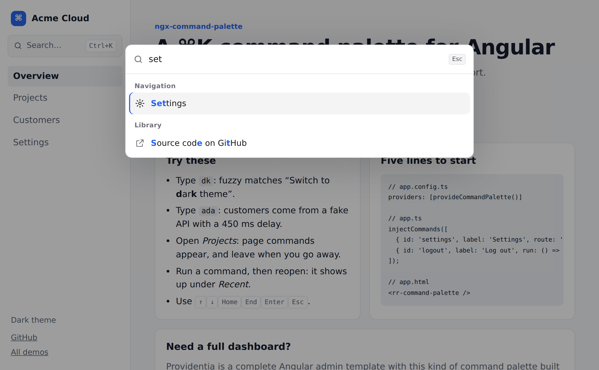
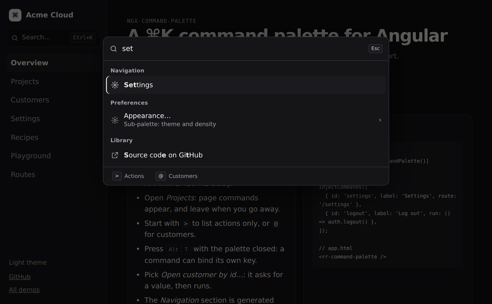

# ngx-command-palette

An accessible **⌘K / Ctrl+K command palette for Angular**. A modern equivalent of
[cmdk](https://cmdk.paco.me) and [kbar](https://kbar.vercel.app), built the Angular way:
standalone components, signals, zoneless-ready and **no dependencies besides Angular**.

[](https://github.com/rrstudioapps/ngx-command-palette/actions/workflows/ci.yml)
[](https://www.npmjs.com/package/@rrstudioapps/ngx-command-palette)
[](LICENSE)

**[Live demo →](https://demo.rr-dev.eu/command-palette/)**


## Features

- Opens with **⌘K / Ctrl+K** (configurable, multiple shortcuts allowed), closes with **Esc** or a click outside
- **Fuzzy search** with highlighted matches, case and accent insensitive, smart ranking (word starts, consecutive letters)
- Commands grouped in **sections**, with optional **icon**, **description**, **shortcut hint** and extra **keywords**
- Each command either **navigates to a route** or **runs a function**
- Optional **Recent** section, stored in `localStorage`
- **Async providers** (e.g. customer search on your API) with debounce, loading state and request cancellation
- Register commands **from any component** with signals; they are **removed automatically** when the component is destroyed
- Full **keyboard navigation**: ↑ ↓, Home / End, Enter, Ctrl+N / Ctrl+P
- **Accessible**: dialog + combobox/listbox pattern, `aria-activedescendant`, focus trap, focus restore, live region, `prefers-reduced-motion`
- **Themeable** with CSS variables (`--rr-cp-*`), light and dark themes, no Tailwind required
- Custom **templates** for items and the empty state
- No browser globals at import time (SSR friendly), works with or without zone.js

| Light | Dark |
| --- | --- |
|  |  |

## Installation

```bash
npm install @rrstudioapps/ngx-command-palette
```

Requires Angular 21 or 22 (`@angular/core`, `@angular/common`, `@angular/router`).

## Quick start (5 minutes)

**1. Configure it** (optional: without this call the defaults are used).

```ts
// app.config.ts
import { provideCommandPalette } from '@rrstudioapps/ngx-command-palette';

export const appConfig: ApplicationConfig = {
  providers: [
    provideRouter(routes),
    provideCommandPalette({ shortcut: 'mod+k' }),
  ],
};
```

**2. Place the palette once** and register some commands.

```ts
// app.ts
import { Component, inject } from '@angular/core';
import { CommandPaletteComponent, injectCommands } from '@rrstudioapps/ngx-command-palette';

@Component({
  selector: 'app-root',
  imports: [CommandPaletteComponent, RouterOutlet],
  template: `
    <router-outlet />
    <rr-command-palette />
  `,
})
export class App {
  private auth = inject(AuthService);

  constructor() {
    injectCommands([
      { id: 'home', label: 'Home', group: 'Navigation', route: '/' },
      { id: 'settings', label: 'Settings', group: 'Navigation', route: '/settings', keywords: ['preferences'] },
      { id: 'logout', label: 'Log out', icon: '🚪', run: () => this.auth.logout() },
    ]);
  }
}
```

**3. Press ⌘K / Ctrl+K.** That's it.

**4. Add page commands** from any component. They exist only while the component is alive.
Pass a signal to keep them in sync with your state:

```ts
@Component({ /* … */ })
export class ProjectsPage {
  projects = signal<Project[]>([]);

  constructor() {
    injectCommands(
      computed(() => [
        { id: 'project-new', label: 'New project', group: 'Projects', run: () => this.create() },
        ...this.projects().map((p) => ({
          id: `project-${p.id}`,
          label: `Open ${p.name}`,
          group: 'Projects',
          route: ['/projects', p.id],
        })),
      ]),
    );
  }
}
```

**5. Search your API** with an async provider:

```ts
injectCommandProvider({
  id: 'customers',
  group: 'Customers',
  minQueryLength: 2,
  search: async (query, signal) => {
    const res = await fetch(`/api/customers?q=${encodeURIComponent(query)}`, { signal });
    const customers: Customer[] = await res.json();
    return customers.map((c) => ({
      id: `customer-${c.id}`,
      label: c.name,
      description: c.email,
      route: ['/customers', c.id],
    }));
  },
});
```

`search` can also return an Observable (e.g. from `HttpClient`): anything with a `subscribe` method works.

## API

### `provideCommandPalette(options?)`

| Option | Type | Default | Description |
| --- | --- | --- | --- |
| `shortcut` | `string \| string[]` | `'mod+k'` | Toggle shortcut(s). `mod` is ⌘ on macOS/iOS and Ctrl elsewhere. Examples: `'ctrl+shift+p'`, `'/'`. Shortcuts without Ctrl/⌘/Alt are ignored while typing in a field. |
| `theme` | `'light' \| 'dark' \| 'auto'` | `'auto'` | `auto` follows `prefers-color-scheme`. |
| `recent` | `{ max?, storageKey? } \| false` | `{ max: 5, storageKey: 'rr-cp:recent' }` | "Recent" section shown when the query is empty. |
| `debounceMs` | `number` | `200` | Debounce for async providers. |
| `maxResults` | `number` | `50` | Max local results for a non-empty query. |
| `filter` | `(query, command) => { score, indices } \| null` | built-in fuzzy search | Your own matching and ranking of local commands. See [Custom search](#custom-search). |
| `labels` | `Partial<CommandPaletteLabels>` | English | All texts, for translations: `placeholder`, `dialog`, `listbox`, `empty`, `loading`, `recent`, `defaultGroup`, `results` (`'{count} results'`), `closeHint`. |

### Custom search

By default commands are matched with the built-in fuzzy search (label, keywords, description). Pass `filter`
to decide what matches and how results are ranked. Return `null` to hide a command; a higher `score` ranks first,
and `indices` are the label characters to highlight:

```ts
provideCommandPalette({
  // Only commands whose label starts with the query
  filter: (query, command) =>
    command.label.toLowerCase().startsWith(query.toLowerCase())
      ? { score: 1, indices: Array.from({ length: query.length }, (_, i) => i) }
      : null,
});
```

`filter` only applies to local commands with a non-empty query. Results of async providers keep the order
returned by your API. To build on the default behavior, call the exported `matchCommand(query, command)`.

### `Command`

| Field | Type | Description |
| --- | --- | --- |
| `id` | `string` | Unique and stable (used for recents). |
| `label` | `string` | Shown and searched. |
| `group` | `string?` | Section. Default: `labels.defaultGroup`. |
| `description` | `string?` | Second line, searched with a lower weight. |
| `icon` | `string \| TemplateRef?` | Emoji/text/icon-font ligature, or a template (e.g. an SVG). |
| `shortcut` | `string[]?` | Keys shown on the right, e.g. `['⌘', 'S']`. Display only. |
| `keywords` | `string[]?` | Extra search terms, not shown. |
| `disabled` | `boolean?` | Shown but not selectable. |
| `hidden` | `boolean \| (() => boolean)?` | Not listed and not searched. A function or a signal hides it depending on your app state, e.g. `hidden: () => !user()`. |
| `route` + `navigationExtras` | `string \| any[]`, `NavigationExtras?` | Navigate with the Angular router… |
| `run` | `(ctx: { query }) => void \| Promise` | …or run a function. |

### `CommandPaletteService`

| Member | Description |
| --- | --- |
| `isOpen`, `query`, `loading` | Read-only signals. |
| `commands`, `sections` | Registered commands and the filtered, grouped results (signals). |
| `open(query?)`, `close()`, `toggle()` | Open/close programmatically (e.g. from a "Search…" button). |
| `setQuery(query)` | Change the search text. |
| `register(commands \| signal, destroyRef?)` | Returns an unregister function. Inside an injection context it unregisters on destroy. |
| `registerProvider(provider, destroyRef?)` | Same, for async providers. |
| `execute(command)` | Run a command as if selected. |
| `clearRecent()` | Forget the recents. |

`injectCommands(commands)` and `injectCommandProvider(provider)` are shortcuts for
`register`/`registerProvider` bound to the current component.

### `CommandProvider`

| Field | Type | Description |
| --- | --- | --- |
| `id`, `group` | `string` | Provider id and section title. |
| `search(query, signal)` | `Promise<Command[]> \| Observable<Command[]>` | `signal` is aborted when the query changes or the palette closes. |
| `minQueryLength` | `number?` | Default `1`. |
| `debounceMs` | `number?` | Overrides the global debounce. |

Async results keep the order returned by your API. Route commands from a provider are kept
in "Recent" even when they are no longer returned by the search.

### `<rr-command-palette>`

| Input | Description |
| --- | --- |
| `theme` | Overrides the configured theme, e.g. `[theme]="appTheme()"` to follow your own toggle. |

The component also exposes `shortcutLabel` (`'⌘K'` or `'Ctrl+K'`) for your search button:
`<rr-command-palette #cp />` … `<kbd>{{ cp.shortcutLabel }}</kbd>`.

### Custom templates

```html
<rr-command-palette>
  <ng-template rrCommandItem let-command let-segments="segments" let-active="active">
    <my-icon [name]="command.id" />
    <span>
      @for (s of segments; track $index) {
        @if (s.match) { <b>{{ s.text }}</b> } @else { {{ s.text }} }
      }
    </span>
    @if (active) { <span class="hint">↵</span> }
  </ng-template>

  <ng-template rrCommandEmpty let-query>
    No results for “{{ query }}”. <a href="/help">Need help?</a>
  </ng-template>
</rr-command-palette>
```

Import `CommandItemTemplate` and `CommandEmptyTemplate` next to `CommandPaletteComponent`.
The item context also has `result` (score and indices) and `query`.

### Utilities

`fuzzyMatch(query, text)` returns `{ score, indices } | null`. `highlightSegments(text, indices)`
splits a string for highlighting. `parseShortcut`, `matchesShortcut` and `formatShortcut`
handle shortcut strings. All of them are exported if you want the same behaviour elsewhere.

## Theming

The styles use CSS variables with zero-specificity defaults, so any rule of yours wins.
Set them on `.rr-cp` (the overlay), and on `.rr-cp[data-theme='dark']` for the dark theme:

```css
.rr-cp {
  --rr-cp-accent: #e11d48;
  --rr-cp-highlight: #e11d48;
  --rr-cp-radius: 16px;
  --rr-cp-font: 'Inter', sans-serif;
}

.rr-cp[data-theme='dark'] {
  --rr-cp-bg: #0f0f12;
}
```

| Variable | Purpose |
| --- | --- |
| `--rr-cp-bg`, `--rr-cp-fg`, `--rr-cp-muted`, `--rr-cp-border` | Surface, text, secondary text, borders |
| `--rr-cp-accent` | Active row marker, spinner |
| `--rr-cp-item-active-bg` | Active row background |
| `--rr-cp-highlight`, `--rr-cp-highlight-bg` | Matched characters |
| `--rr-cp-kbd-bg`, `--rr-cp-kbd-fg` | Shortcut keys |
| `--rr-cp-backdrop`, `--rr-cp-shadow` | Overlay and dialog shadow |
| `--rr-cp-font`, `--rr-cp-font-size` | Typography |
| `--rr-cp-width`, `--rr-cp-max-height`, `--rr-cp-top` | Dialog size and position |
| `--rr-cp-radius`, `--rr-cp-item-radius` | Corners |
| `--rr-cp-z-index`, `--rr-cp-duration` | Stacking and animation length |

Class names (`rr-cp-dialog`, `rr-cp-item`, `rr-cp-item-active`, `rr-cp-match`, `rr-cp-group-label`,
`rr-cp-empty`, …) are stable too, if you need more than variables.

## Accessibility

- The palette is a modal `role="dialog"` with `aria-modal="true"` and a label.
- The search field is a `role="combobox"` that controls a `role="listbox"`. Sections are
  `role="group"` with a label. The active option is announced through `aria-activedescendant`,
  so the focus never leaves the input.
- Disabled commands use `aria-disabled` and are skipped by the keyboard.
- Focus is trapped inside the dialog and **restored** to the previously focused element on close.
- A polite live region announces the number of results and the loading state.
- Animations are disabled with `prefers-reduced-motion: reduce`, and active rows and matches
  stay visible in Windows high contrast mode (`forced-colors`).
- The demo is checked with axe-core: 0 violations in light and dark themes.

## Development

```bash
npm install
npm start            # demo on http://localhost:4200
npm test             # unit tests (Vitest)
npm run lint
npm run build        # library (dist/ngx-command-palette) + demo
```

See [CONTRIBUTING.md](CONTRIBUTING.md).

## License

[MIT](LICENSE) © 2026 rrstudio

## Need a full dashboard? Check out Providentia

**Providentia** is a complete Angular admin dashboard template by the same author: analytics,
customer tables, report builder, billing, roles, light and dark themes, and a command palette
built in.

**[See the Providentia live demo →](https://demo.rr-dev.eu/providentia/overview)**
